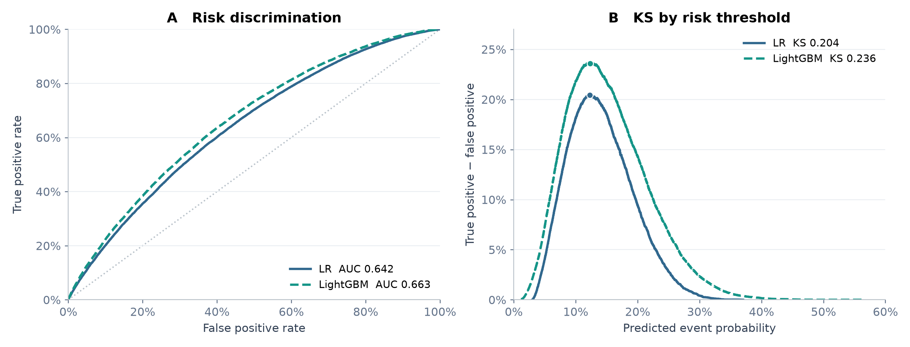
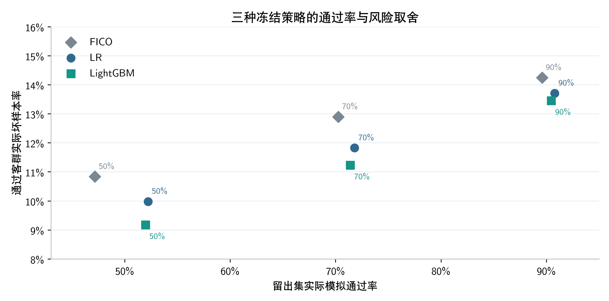

# LendingClub 信贷风险分析与准入策略评估

基于公开贷款数据，完成数据审计、WOE评分卡、树模型对照及冻结准入策略评估。当前主展示为 **36期已决贷款批次回溯研究**，正式运行 `20261111T144556`，仓库更新于2026-11-16。

[完整研究报告 PDF](docs/current-scorecard/LendingClub_风险评分卡研究报告.pdf) · [当前复现代码](scorecard_2026/README.md) · [聚合结果表](scorecard_2026/results/)

## 研究问题与工作内容

相较仅用 FICO 排序，多字段模型能否改善已放款客群的风险区分与模拟准入？

- 审计2,260,701行、151列，构建529,915笔36期已决贷款样本。
- 按放款月份隔离训练、调参、校准、策略验证和留出集，排除评级、利率及贷后字段。
- 构建8变量WOE-LR评分卡，与LightGBM对照；比较完整建模流程，不宣称纯算法增益。
- 冻结策略阈值，分析通过量、通过坏率、误拒和漏放，诊断校准及分组风险低估。

## 模型效果

留出集为2015年1—9月放款的194,357笔已决贷款，实际坏样本率14.92%。

| 方法 | AUC | KS |
|---|---:|---:|
| FICO | 0.6014 | 0.1537 |
| WOE-LR | 0.6420 | 0.2044 |
| LightGBM | 0.6628 | 0.2360 |

## 冻结准入策略

70%为策略验证集开发目标，阈值固定后应用于留出集。

| 方法 | 留出模拟通过率 | 通过客群坏样本率 |
|---|---:|---:|
| FICO | 70.26% | 12.90% |
| WOE-LR | 71.80% | 11.82% |
| LightGBM | 71.40% | 11.23% |

LightGBM相对FICO净多通过4,250笔好样本、净少通过2,029笔坏样本，总通过量净增2,221笔。**通过量不同，这是离线固定策略比较，不是等量实验、真实新增客户或线上收益。**

## 概率低估诊断

LR与LightGBM平均预测为12.80%、12.92%，低于实际14.92%。DTI≥25%组实际坏率19.54%，两模型预测15.52%、16.18%。分数分布PSI较低仍可能存在概率低估；后续校准需新的开发与检验样本。

## 数据与验证设计

| 集合 | 放款月份 | 样本数 |
|---|---|---:|
| 训练 | 2007-06—2013-12 | 172,988 |
| 调参验证 | 2014-01—2014-04 | 47,339 |
| 校准保留 | 2014-05—2014-08 | 57,840 |
| 策略验证 | 2014-09—2014-12 | 57,391 |
| 较晚批次留出 | 2015-01—2015-09 | 194,357 |

来源：[Kaggle wordsforthewise/lending-club](https://www.kaggle.com/datasets/wordsforthewise/lending-club)。Fully Paid=0，Charged Off/Default=1，排除未决样本。校准本次未触发，保留集未挪作训练。

统一状态快照和标签确认时间未知，不是严格历史回测；借款人标识缺失，无法保证借款人跨集合隔离。2015批次曾用于旧项目，仅保证本轮开发隔离，不是首次未见外部验证。不覆盖拒绝客群，概率不是一年违约率，无经营收益结论。FICO策略、分组诊断及案例是事后描述扩展。

## 交付与复现

- `scorecard_2026/src/`、`configs/`、`tests/`：当前实现、配置和核心测试。
- `scorecard_2026/results/`：聚合模型、策略、评分、校准与稳定性结果。
- `docs/current-scorecard/`：最新研究报告及图表。
- [复现说明](scorecard_2026/README.md)：使用 --data 指定自备原始文件，不发布逐笔数据或模型。

原运行保存6个关键测试、115项独立脚本检查，最大指标数值差约1.11×10⁻¹⁶。本次为发布适配与代码验证，未完整重训；历史核验与本次检查分开记录。

## 历史研究

[旧版四字段／80%同量保留研究](README_legacy.md)及原根目录代码保留。旧版基于Zenodo的134.8万笔整理数据，与当前Kaggle多字段研究不是同一实验，请勿混用结果。
